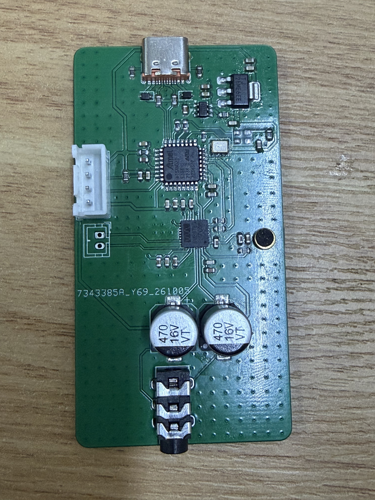

# Coral-Wave

基于 ATSAMD21E18A 与 WM8978 的 USB 声卡，提供双声道播放、单声道麦克风采集和 Windows 调参工具。

[使用与调音](docs/usage.md) · [编译与烧录](docs/firmware.md) · [硬件与引脚](docs/hardware.md) · [测试与限制](docs/testing.md)

已有安装引导程序的板子时，用 USB-C 连接电脑，打开 [Coral-Wave-Control.exe](Firmware/releases/Coral-Wave-Control.exe)。
Windows 运行环境与完整操作见[使用说明](docs/usage.md)。
空白主控须先通过 SWD [安装引导程序](docs/firmware.md#首次通过-swd-安装)。

照片由用户于 2026-10-17 提供，拍摄时 Y2 尚未安装；同日后续录放音实测已补装 Y2。
[局部照片与设计图](docs/hardware.md#实物与设计图)保留了调试阶段的外观，不能代替最终装配清单。

## 已实现的功能

- USB Audio Class 1.0，固定 **48 kHz、16 位**，双声道播放、单声道麦克风采集。
- Windows 系统播放与录音音量、静音控制。
- 上位机调节 WM8978 的五段 EQ、耳机及麦克风增益、高通、ALC、噪声门和限幅等参数。
- JSON 预设导入导出、参数掉电保存，以及安装引导程序后的 USB 固件更新。
- 本地 CLI 和 stdio MCP 接口，共用 USB 通信与固件包校验代码。

耳机播放、麦克风采集和 USB 更新有 [2026-10-17 实板记录](docs/testing.md#已有实板证据)。
SPK2 是预留的扬声器硬件接口，当前固件没有完整的 BTL 输出配置及实测记录。
仓库没有 SNR、THD、最大输出功率等模拟性能实测数据。

## 文档入口

| 内容 | 文档 |
| --- | --- |
| USB、I²S、控制链路与双时钟结构 | [系统架构](docs/architecture.md) |
| 关键器件、供电、SWD 和音频接口 | [硬件设计与引脚](docs/hardware.md) |
| 开发环境、编译、首次安装、USB 更新与恢复 | [固件编译与烧录](docs/firmware.md) |
| 播放、录音、调音、预设和 CLI | [使用方法](docs/usage.md) |
| 可复现检查、历史实测、已知问题 | [测试记录与限制](docs/testing.md) |
| AI 客户端接入与底层 HID 格式 | [MCP](Documentation/MCP.md)、[USB 控制协议](Documentation/USB-Protocol.md) |
| 芯片数据手册 | [资料索引](Documentation/README.md) |

完整导航及文档维护范围见 [docs/README.md](docs/README.md)。

## 仓库结构

| 目录 | 内容 |
| --- | --- |
| [docs](docs/) | 面向当前工程的设计、开发与使用说明 |
| [Documentation](Documentation/) | 数据手册、协议参考及按日期保存的检查证据 |
| [Firmware](Firmware/) | 固件、引导程序、Windows 上位机、预编译文件和测试工具 |
| [Hardware](Hardware/Coral-Wave.kicad_pro) | KiCad 10 工程、项目器件库与专用 3D 模型 |
| [Images](Images/README.md) | 实物照、PCB 预览与项目图标的来源说明 |

## 参与修改

提交问题时附上固件版本、Windows 版本、复现步骤及 CLI 状态输出。
修改固件前按[编译说明](docs/firmware.md)建立环境，修改后选择[对应测试](docs/testing.md)。
修改硬件后重新导出当前网表并执行 ERC、拓扑检查和 DRC；已有录放音记录不构成新版本硬件的制造放行。

## 许可证

仓库目前没有项目级 `LICENSE` 文件，项目自有代码、硬件与文档的整体许可证尚未明确。
本次文档整理不代为选择许可证。
第三方依赖分别保留 [MIT 或 Apache-2.0 许可证](Firmware/third_party/README.md)，珊瑚 Logo 使用[独立 MIT 授权](Images/coral-logo.LICENSE)。
这些授权的适用范围限于相应材料。
