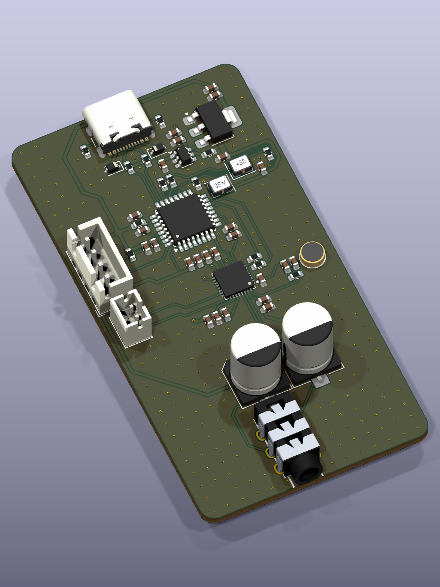

# Coral-Wave

一块用 ATSAMD21E18A 和 WM8978 做的 USB 声卡。硬件有耳机、麦克风和扬声器接口，工程用 KiCad 10 打开。

2026-10-17 实板录放音已通过测试。电脑播放能从耳机口听到左右声道，板载麦克风可以录到电脑，录音回放也已确认清楚。格式为 **48 kHz、16 位，双声道播放和单声道采集**。

Y1 使用 12 MHz 有源时钟，Y2 使用 12.288 MHz 有源时钟。固件通过 DMA 连接 USB 与 I²S，并用 USB 反馈补偿音频时钟的微小频差。Windows 可以直接调播放、麦克风的音量和静音。

| 目录 | 内容 |
| --- | --- |
| [Documentation](Documentation/) | 主控与 WM8978 手册、实测记录 |
| [Firmware](Firmware/) | USB 固件、预编译文件、芯片自检与测试工具 |
| [Hardware](Hardware/Coral-Wave.kicad_pro) | KiCad 工程、器件库和 3D 模型 |
| [Images](Images/) | 项目标识与 PCB 预览 |

供电和音频接板上 USB-C，下载接 J2 的 SWD。首次使用见 [固件说明](Firmware/README.md)，本次结果见 [录放音实测](Documentation/Reports/audio/2026-10-17/review.md)。

