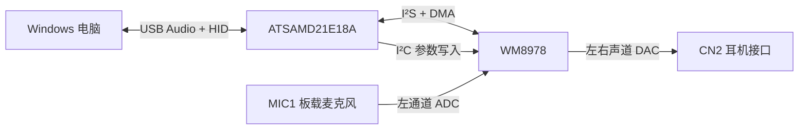

# 系统架构

Coral-Wave 将 USB 音频、I²S 音频和 HID 控制放在同一块板上。
主控负责 USB 传输与缓冲，WM8978 负责 ADC、DAC 和芯片内部的音频处理。

## 音频与控制链路

播放数据从 USB OUT 进入环形缓冲，再经 DMA 送到 I²S serializer 0。
采集使用 serializer 1，将 WM8978 左通道 ADC 的样本送到 USB IN。
当前 USB 描述符只声明一种音频格式，具体规格见[项目入口](../README.md#已实现的功能)。
SPK2 未列入已实现的音频链路，原因见[功能边界](testing.md#已知问题与尚未验证内容)。

## 两个独立时钟域

Y1 为 MCU 提供参考，MCU 的 DFLL 建立 USB 所需时钟。
Y2 独立驱动 WM8978 的 MCLK；当前固件关闭 codec PLL，由 WM8978 输出 BCLK 和 LRCLK，SAMD21 为 I²S 从机。
频率、引脚和串阻对应关系见[硬件时钟表](hardware.md#时钟与数字信号)。

USB 帧时钟与 codec 音频时钟没有锁相。
播放端根据缓冲占用调整显式 USB 反馈；DMA 与环形缓冲承接两个时钟域之间的数据。
现有短时录放音测试未覆盖任意时长、任意主机环境下的缓冲状态。

## 调参和保存

GUI、CLI、MCP 都通过 Windows HID Feature Report 访问同一套控制协议。
主机端按设备序列号协调访问，固件逐步写入需要改变的 WM8978 寄存器。
“读取设置”与寄存器诊断返回软件镜像，控制接口不读取 WM8978 的实际寄存器值。

参数应用与掉电保存是两项操作。
保存会在音频空闲时写入两份交替使用、带代数和 CRC 的 Flash 记录，并重启设备。
EQ 与 3D 固定用于 DAC 播放路径；ALC 作用于板载麦克风使用的左通道。
操作及参数范围由[使用方法](usage.md#调节音频参数)维护。

## 引导程序与应用

引导程序和应用是独立镜像。
空白主控先经 SWD 安装组合镜像，之后通过 USB 更新应用。
更新流程先使旧应用有效标记失效，再顺序写入并校验新应用，最后提交元数据。
中断恢复依赖仍然可运行的引导程序，不提供旧版本自动回滚。
地址布局和包格式见 [USB 控制协议](../Documentation/USB-Protocol.md)。

## 实现位置

| 职责 | 源文件 |
| --- | --- |
| MCU、外部参考和 USB 时钟 | [board.c](../Firmware/common/board.c) |
| USB 音频格式与端点 | [usb_descriptors.c](../Firmware/usb-audio/usb_descriptors.c) |
| I²S、DMA、音量与反馈 | [audio.c](../Firmware/usb-audio/audio.c) |
| WM8978 参数校验、应用与保存 | [control.c](../Firmware/usb-audio/control.c) |
| HID 报告及命令编号 | [protocol.h](../Firmware/common/protocol.h)、[protocol.c](../Firmware/common/protocol.c) |
| 固件校验和 USB 更新 | [Device.cs](../Firmware/host/Device.cs)、[引导程序](../Firmware/bootloader/main.c) |
| GUI 与 MCP | [MainForm.cs](../Firmware/host/MainForm.cs)、[McpServer.cs](../Firmware/host/McpServer.cs) |

USB 栈使用 TinyUSB；SAMD21 驱动中的本地改动和授权见[第三方依赖](../Firmware/third_party/README.md)。
