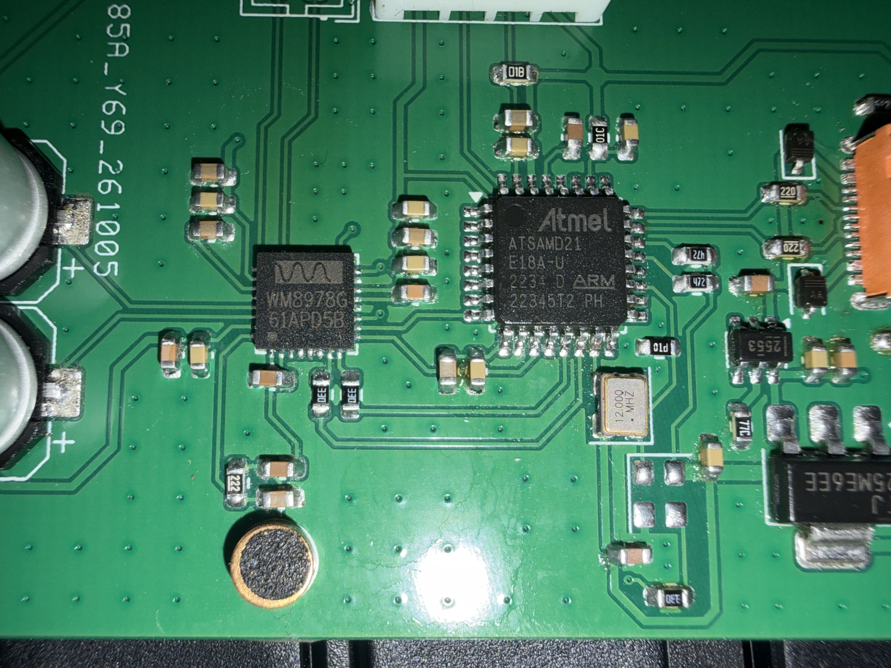

# 硬件设计与引脚

正式工程为 [Hardware/Coral-Wave.kicad_pro](../Hardware/Coral-Wave.kicad_pro)，使用 KiCad 10 打开。
当前原理图与 PCB 均包含 54 个器件，PCB 为双层板。
以下表格以工程中的位号、引脚号和网络为准；制造及装配待确认项见[测试与限制](testing.md#已知问题与尚未验证内容)。

## 实物与设计图

局部照中 Y2 焊位为空，MCU 丝印可见 `ATSAMD21 E18A-U`，codec 丝印可见 `WM8978G`。
它们与下表工程值的完整后缀不一致，仓库没有足以核定实物完整订货码的采购记录。
型号后缀、封装及实物兼容性仍需按实际采购件确认。
Y2 在后续音频测试前已补装，经过见[实板记录](../Documentation/Reports/audio/2026-10-17/review.md)。

预览展示设计装配；项目专用模型随仓库保存，标准模型依赖 KiCad 10 的 3D 库。
CN2 使用五脚适配模型，未经修改的六脚原库文件也保留，见[模型来源与适配范围](../Hardware/WM8978.3dshapes/README.md)。

## 关键器件与供电

| 位号 | 当前工程值 | 职责 |
| --- | --- | --- |
| U1 | ATSAMD21E18A-A | USB、I²S、DMA 与 I²C 控制；工程封装为 TQFP-32 |
| U16 | WM8978CGEFL/RV | 音频 ADC、DAC、耳机输出及芯片内部处理；工程封装为 QFN-32-1EP |
| U17 | TPS2553DBVR | USB 入口后的限流电源开关 |
| U15 | TLV1117LV33DCYR | 3.3 V 稳压 |
| Y1 | 12 MHz / 3.3 V / 50 ppm | MCU 参考用有源振荡器 |
| Y2 | 12.288 MHz / 3.3 V / 50 ppm | WM8978 MCLK 用有源振荡器 |
| USB2 | USB-C USB2 DEVICE | USB 供电与数据；项目封装对应 GCT USB4105-GF-A |
| MIC1 | ELECTRET MIC | 板载驻极体麦克风，接左通道输入支路 |
| CN2 | HEADPHONE 3.5mm | 经隔直电容连接耳机左右声道 |
| SPK2 | SPEAKER 8R BTL | 预留差分扬声器输出接口 |

器件表描述设计选型，不是已经核实的实板采购 BOM。
`50 ppm` 和 `8R` 等数值为工程标注，不代表本次测量结果。
完整选型、封装与元件值查[原理图](../Hardware/Coral-Wave.kicad_sch)。

USB VBUS 进入 `VBUS_RAW`，经 U17 输出 `VBUS_5V`，再送 U15 和 codec 的 SPKVDD 支路。
U15 提供 MCU 和 codec 其他电源使用的 `+3V3`。
J2.1 与板上 `+3V3` 直接相连，调试器接此脚作为 VTref；连接 SWD 时按安装步骤给板子接 USB 电源。
接口供电、电流预算、温升和模拟性能不能仅凭网络连接判定通过。

## 时钟与数字信号

GPIO 名称与封装引脚号是两个编号体系。
例如 PA22 对应 U1 的 21 脚，PA24 对应 U1 的 23 脚。

| 信号 | MCU GPIO / U1 引脚 | 对端与连接 | 方向或用途 |
| --- | --- | --- | --- |
| MCU 参考 | PA14 / 15 | Y1.3，`MCU_12M` | 12 MHz 输入 |
| Codec MCLK | 不接 MCU 时钟输出 | Y2.3 → R73 33 Ω → U16.11 | 独立 12.288 MHz 输入 |
| 振荡器使能 | PA18 / 19 | Y1.1、Y2.1，R74 下拉 | MCU 输出，高电平使能 |
| I²C SDA | PA22 / 21 | U16.17，R63 上拉 | SERCOM3 PAD0，codec 控制 |
| I²C SCL | PA23 / 22 | U16.16，R64 上拉 | SERCOM3 PAD1，codec 控制 |
| I²S DAC 数据 | PA07 / 8 | U16.10 DACDAT | MCU → codec |
| I²S ADC 数据 | PA08 / 11 | U16.9 ADCDAT | codec → MCU |
| I²S BCLK | PA10 / 13 | U16.8 → R75 33 Ω → MCU | codec → MCU，固件按 32 位双时隙配置 |
| I²S LRCLK | PA11 / 14 | U16.7 → R76 33 Ω → MCU | codec → MCU |
| USB D− | PA24 / 23 | R54 → USB2.A7/B7，含保护支路 | 全速 USB 数据 |
| USB D+ | PA25 / 24 | R53 → USB2.A6/B6，含保护支路 | 全速 USB 数据 |

固件使用 7 位 I²C 地址 `0x1A`；[audio.c](../Firmware/usb-audio/audio.c) 中的 `0x34` 是包含写方向位的地址表示。
GPIO 复用与时钟启动代码见 [board.c](../Firmware/common/board.c) 和 [audio.c](../Firmware/usb-audio/audio.c)。
Y1/Y2 都是有源振荡器，其引脚为 1=EN、2=GND、3=OUT、4=VDD；不要以同频无源晶体替代。

## 外部接口

### J2 SWD

J2 是 **JST XH 2.50 mm 四针**接口，并非标准 10/20 针调试排线。
针序按 KiCad 焊盘编号识别，不按照片观察方向推定。

| J2 引脚 | 信号 | 板内连接 |
| --- | --- | --- |
| 1 | 3V3 / VTref | `+3V3` |
| 2 | SWDIO | U1.32 / PA31 |
| 3 | SWCLK | U1.31 / PA30 |
| 4 | GND | 公共地 |

此接口没有 RESET 引脚。

### CN2 耳机与 MIC1

| 连接 | 实际路径 |
| --- | --- |
| CN2.4，Tip / 左声道 | U16.30 LOUT1 → C87 → CN2.4 |
| CN2.3，Ring / 右声道 | U16.29 ROUT1 → C86 → CN2.3 |
| CN2.2，Sleeve | GND |
| MIC1.1 | 麦克风偏置与输入耦合支路 |
| MIC1.2 | GND |

CN2 是耳机输出，板载 MIC1 是录音来源；工程没有将耳机口定义成带麦克风的 TRRS 输入。

### SPK2 预留扬声器接口

SPK2.1 接 U16.23 ROUT2，SPK2.2 接 U16.25 LOUT2，两端都不是 GND。
当前应用只配置了已验证的耳机和麦克风通路，没有完整的 BTL 输出配置与测量数据。
不能据接口标注推断扬声器已经可用、输出功率或允许负载。
